  

I'm a full-stack engineer who wandered into LLM systems and application security, then stayed. Since 2021 I've shipped React component libraries, Django APIs, LLM pipelines and Kubernetes manifests. Some features needed all four.

These days I'm employee #4 at [Seezo](https://seezo.io), where LLMs review software designs for security flaws before anyone writes the code. My job is making that hold up when a real customer is watching.

## The main quest is private

Roughly 4 in 5 of my 5,000+ contributions live in private repos, so most of my graph is anonymous green squares. Here's what's behind them.

| | What I've built at Seezo |
|---|---|
| **LLM plumbing** | Structured outputs that survive AWS Bedrock, prompt caching through LiteLLM, and concurrency caps that ride out proxy timeout storms |
| **Performance** | Per-tenant LLM config behind an LRU cache of frozen, structurally shared dataclasses. Also deleted a per-row correlated subquery from the main dashboard |
| **Security** | Immutable audit logging with a SIEM pull endpoint, error sanitising so secrets never reach the logs, OIDC redirect state kept out of query strings |
| **Range** | One Slack feature across four repos: Django code, a self-supervising listener, an ECS service and a Kubernetes deployment |
| **Quality** | The Playwright E2E suite and its CI, built from nothing and kept green through a Tailwind v4 migration and a platform rewrite |

This year I've reviewed more pull requests than I've opened: 263 against 216, as of October 2026. Somewhere along the way I became the person the code goes through.

## Side quests

Public, built on weekends, usually because something was annoying me.

| Repo | What it does | Built with |
|---|---|---|
| [**strata**](https://github.com/pruthvi2103/strata) | See what's actually eating your disk. WinDirStat for macOS that reads metadata in bulk: 3.3× faster than `readdir` + `lstat`, a 3.7M-file boot disk in 28.7s | Rust, Tauri |
| [**presenta**](https://github.com/pruthvi2103/presenta) | Slides as React components on a fixed 1920×1080 canvas, so the TV and the Meet share see the same slide. Your phone is the clicker | Next.js, SSE |
| [**pdf-unlock**](https://github.com/pruthvi2103/pdf-unlock) | Bank statements arrive password-locked and break every automation. This writes a plain copy and keeps passwords in the OS keyring | Python |
| [**hover-design**](https://github.com/pruthvi2103/hover-design) | A React component library a bunch of us built at AntStack. I led it | React, vanilla-extract |
| [**png-to-webp**](https://github.com/pruthvi2103/png-to-webp) | PNG to WebP from the terminal, for frontend folks with heavy asset folders | TypeScript |

<b>The archaeology layer</b> (2019 to 2023)

 

| Repo | What it was |
|---|---|
| [tedxjnec2019website](https://github.com/pruthvi2103/tedxjnec2019website) | My first real commit, August 2019. 59 commits of plain HTML |
| [covued](https://github.com/pruthvi2103/covued) | A live COVID-19 case tracker in Vue, built during the 2020 lockdown |
| [use-debounce](https://github.com/pruthvi2103/use-debounce) | A tiny React hook that debounces things |
| [Polymorph](https://github.com/pruthvi2103/Polymorph) | My FOSSHack 2023 entry |
| [DSADOD](https://github.com/pruthvi2103/DSADOD) | Competitive programming, in Rust and Python |

## Things I reach for

  

On the LLM side: LiteLLM, AWS Bedrock, structured outputs and prompt caching. Vue was the first framework I really thought in, so it stays on the list.

## My graph, being eaten

<picture>
  <source media="(prefers-color-scheme: dark)" srcset="https://raw.githubusercontent.com/pruthvi2103/pruthvi2103/output/snake-dark.svg">
  <source media="(prefers-color-scheme: light)" srcset="https://raw.githubusercontent.com/pruthvi2103/pruthvi2103/output/snake.svg">
  
</picture>

A GitHub Action redraws this every night. The snake counts the private squares too, which makes it better informed than my profile.

## Things that are true

- Leaving an org makes GitHub forget your private work. About 200 of my PRs vanished that way, so I rebuilt the record from GitHub's notification emails in my inbox.
- My first real commit was a TEDx website in 2019. Two years later I led engineering for the 2021 edition: 287 commits and 44 reviews in one repo.
- I've judged a hackathon: Hack3, 375+ high schoolers from 54 countries.
- My Hacktoberfest 2020 PR was written in Rust. It got merged.
- My notes, workouts and budget live in an Obsidian vault that Claude helps me run. This README was drafted in there.
- Weekends default to anime and games.

## Say hi

 

